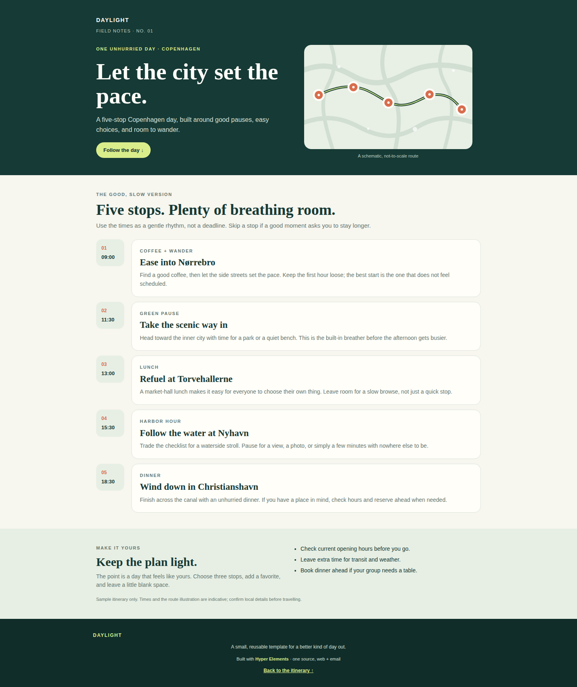
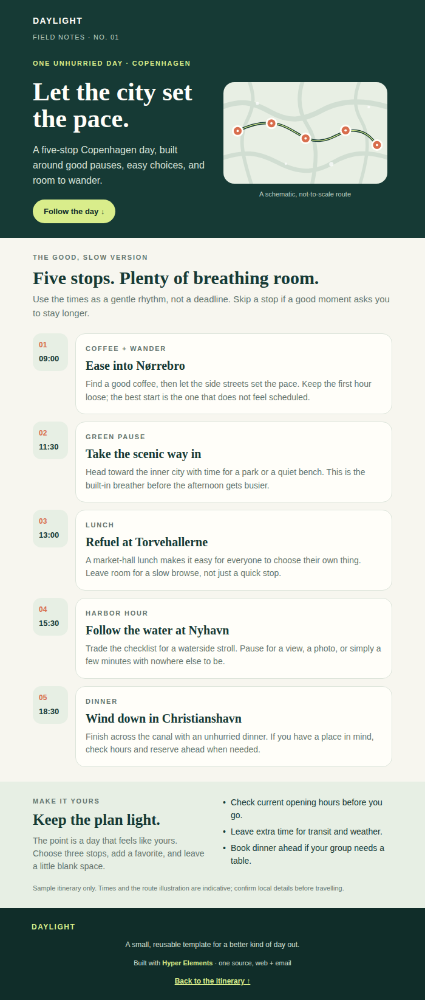

# Daylight — Copenhagen, in one unhurried day

Daylight is a small, remixable city-guide template: one itinerary becomes both a responsive web page and an email. The example follows a relaxed day through Copenhagen, with flexible timing, a clear stop-by-stop rhythm, and a simple original route illustration.

## Preview

**Web page**



**Email version**



## Why Hyper Elements

The shared `GuideContent` component in [`src/guide.tsx`](src/guide.tsx) is wrapped once in Hyper Elements' `Page` root and once in its `Email` root. The same route stops, copy, visual theme, and reusable cards therefore produce two different outputs from one source. The build script runs `validate()` and saves `outline()` for both outputs before writing the responsive page HTML, email-safe HTML, and email plain text.

## Run it locally

Requirements: Node.js 20 or newer.

```bash
npm install
npm run build
```

`npm run check` runs the strict TypeScript check and rebuilds/validates both outputs.

Generated files are written to `dist/`:

- `daylight-page.html` — responsive web page.
- `daylight-email.html` — email-safe HTML.
- `daylight-email.txt` — plain-text email.
- `outline-page.txt` and `outline-email.txt` — readable Hyper Elements layout outlines.

Open `dist/daylight-page.html` in a browser to view the web version. No API key, hosted service, or network request is needed to build the templates.

## Remix the guide

Edit the `stops` array in `src/guide.tsx` to change the times, neighborhoods, and descriptions. Update the palette in the `C` object and edit `public/copenhagen-route.svg` if you want a different route illustration. Run `npm run build` again to regenerate both formats.

The itinerary is an illustrative sample, not live travel advice. Timings and the schematic route are indicative; check venue opening hours, transit, weather, and reservations before travelling.

## Project files

```text
public/copenhagen-route.svg   Original, schematic route artwork
src/guide.tsx                 Shared content, theme, Page and Email roots
scripts/build.tsx             validate → outline → render → write outputs
assets/                       Rendered screenshots used in this README
```

## Credits

Built with [Hyper Elements](https://github.com/hyper-elements/hyper-elements), an open-source React library. The route illustration is original project artwork; there are no external image assets.
